# HIDRA — Reto 01

**HIDRO360** es el producto: un sistema de coordinación de reportes de falta de agua y propuesta de distribución de cisternas en Panamá Oeste, con **supervisión humana obligatoria** y **auditoría verificable**. **HIDRA — Reto 01** es la entrega y presentación de ese producto al reto (TEAM VIFY AI).

> **Datos ficticios.** Sectores, cisternas y reportes de la demo son inventados. El experimento de impacto es **sintético**: no es evidencia de impacto real.
>
> **Principio rector:** la IA propone; las reglas deterministas calculan; la persona aprueba; nada sensible ocurre automáticamente.

## Equipo

**TEAM VIFY AI**

- Victor David Montes (@VITIDEV06)
- Frida Leis (@yukki2126)
- Yohany Kavacila (@YOHADEV21)

## Problema

En Panamá Oeste, los reportes de falta de agua llegan por canales informales (mensajes, llamadas, redes). La información llega incompleta, se **duplica**, no se puede priorizar de forma transparente y no deja **trazabilidad** de quién decidió qué. Coordinar los carros cisterna termina dependiendo de memoria y criterio no documentado, sin forma de explicar por qué se atendió un sector antes que otro.

## Impacto y solución

**Solución:** HIDRO360 recibe los reportes, los interpreta (reglas locales o Gemini opcional, con fallback declarado), sugiere sector y duplicados, **prioriza con una fórmula determinista** (40 % horas sin servicio · 30 % población afectada · 30 % vulnerabilidad), propone la **asignación de cisternas respetando capacidad** y exige **aprobación humana** antes de cualquier acción. Todo queda auditado con cadena de hashes. Funciona **sin internet ni claves** (modo local).

**Impacto esperado:** menos duplicados, prioridad explicable y repetible, y una pista de auditoría completa.

**Evidencia de impacto:** el experimento `python -m evaluation.run_impacto` compara una línea base contra HIDRO360 sobre datos **sintéticos** con semillas fijas. Es reproducible, **no** una medición de impacto real (ver `docs/EXPERIMENTO_IMPACTO.md`).

## Arquitectura de agentes

Ocho roles con responsabilidad acotada. **Solo dos usan un modelo de lenguaje**, y ambos solo **proponen**; el resto son deterministas o son el humano que aprueba. Detalle completo (entrada, salida, herramientas, autonomía, guardrails, límites y aprobación humana por rol) en **`docs/ARQUITECTURA.md`**.

```mermaid
flowchart LR
    C([Ciudadano]):::ext --> B[Bandeja de reportes]:::ok
    B --> R1[1 · Ingesta<br/>reglas + evidencia]:::ok
    R1 --> R2[2 · Interpretación<br/>local/Gemini + fallback]:::ok
    R2 --> HV1{{Aprobación humana<br/>de la lectura}}:::hum
    HV1 --> R3[3 · Sector y duplicados<br/>sugiere, no fusiona]:::ok
    R3 --> R4[4 · Priorización<br/>fórmula determinista]:::ok
    R4 --> R5[5 · Planificador<br/>flujo máximo]:::ok
    R5 --> R6[6 · Orquestador de<br/>recomendaciones]:::ok
    R6 --> HV2{{Aprobación humana<br/>del plan/misión}}:::hum
    HV2 --> AU[(Auditoría + trazas<br/>cadena de hashes)]:::ok
    HV2 --> M[Misión]:::ok
    M --> R8[8 · Terminal ESP32-S3]:::fut
    R7[7 · Supervisor humano<br/>UI de administración]:::hum --- HV1
    R7 --- HV2

    classDef ok fill:#d9f0e3,stroke:#11643a,color:#0b3b22;
    classDef hum fill:#fff3cf,stroke:#a67c00,color:#5c4400;
    classDef fut fill:#f0f0f0,stroke:#888,stroke-dasharray:5 4,color:#444;
    classDef ext fill:#dbeaf5,stroke:#0f4466,color:#0f4466;
```



| # | Rol | Módulo | ¿IA? | Autonomía |
|---|---|---|---|---|
| 1 | Ingesta | `services/ingest.py` | no | automática (no sensible) |
| 2 | Interpretación local/Gemini + fallback | `services/ia_gemini.py`, `services/ia_tareas.py` | **sí (propone)** | propone |
| 3 | Sector y duplicados | `services/geoloc.py` | no | sugiere; nunca fusiona |
| 4 | Priorización | `services/prioritization.py` | no | calcula (determinista) |
| 5 | Planificador de cisternas | `services/planner.py` | no | propone |
| 6 | Orquestador de recomendaciones | `services/orquestador.py`, `services/workflow_ia.py` | **sí (2 de 6 etapas)** | propone |
| 7 | Supervisor humano | `interface/flet_app/admin/`, `services/workflow.py` | no | **decide** |
| 8 | Terminal ESP32-S3 | `firmware/esp32s3_monitor/`, `api/main.py` | no | ejecuta y reporta |

## Tecnologías y fuentes de datos

| Capa | Tecnología |
|---|---|
| Interfaz | **Flet 1.0.4** (escritorio o web); portal público sin cuenta + administración con login |
| API | **FastAPI** + Uvicorn (`api/main.py`), tokens de operador y de dispositivo |
| Lógica de negocio | Python en `services/` (única puerta: `services/workflow.py`) |
| Datos | **SQLite** (stdlib, por defecto) o **PostgreSQL/Supabase** (`DATABASE_URL`); JSON validado con Pydantic (`SCHEMA_VERSION=1.3`) |
| IA (opcional) | **Gemini** vía SDK `google-genai`, con **fallback local** declarado (`VERSION_REGLAS=reglas-2026.10.a`) |
| Auditoría | Cadena de hashes (`services/audit.py`, `services/tracing.py`) |
| Planificación | Flujo máximo lexicográfico (Edmonds-Karp) con desempate estable |
| Hardware | **ESP32-S3** (terminal de cisterna, firmware que compila, sin probar en placa); Raspberry Pi 4 (sin probar) |
| Despliegue | **Supabase** (Postgres/Storage/Auth) + **Vercel** (API sin estado); UI Flet como proceso Python |

**Fuentes de datos:** los datos de la demo son **ficticios** (`data/`, generados por el equipo). El catálogo de sectores y el glosario de referencias son del dominio y están en el repositorio. Los documentos de origen del reto están en `proyecto_info/`. Los mapas usan **OpenStreetMap** (el navegador necesita internet para las teselas).

## Instalación y ejecución

Requiere Python 3.10+ (probado con 3.14). Con el script de flujo (crea `.venv`, instala, copia `.env.example` a `.env` sin pisarlo):

```powershell
powershell -ExecutionPolicy Bypass -File scripts\dev.ps1 instalar
.\scripts\dev.ps1 admin        # primer administrador (no hay cuentas por defecto)
.\scripts\dev.ps1 ui           # ventana de escritorio   (web: http://127.0.0.1:8501)
.\scripts\dev.ps1 api          # API en http://127.0.0.1:8000/docs
.\scripts\dev.ps1 pruebas      # pytest -q
```

Equivalente manual:

```bash
python -m venv .venv
.venv\Scripts\activate
pip install -r requirements.txt      # desarrollo; el servidor Raspberry usa requirements-servidor.txt
python app.py                  # ventana de escritorio
python app.py --web            # o en el navegador: http://127.0.0.1:8501
pytest -q
```

**Internet:** el modo local de reportes/prioridad/plan no necesita internet ni claves. La **primera** ejecución de escritorio descarga el cliente de Flet (una vez); el modo `--web` carga Flet desde internet en el navegador. Detalle: `docs/INSTALACION.md`.

**Gemini (opcional):**

```bash
copy .env.example .env          # luego GEMINI_API_KEY=...  (.env está en .gitignore)
python -m scripts.verificar_gemini --sin-llamada   # comprueba la configuración sin usar red
python -m scripts.verificar_gemini                  # lista modelos y hace una llamada mínima
```

`AI_PROVIDER=auto` (defecto) usa Gemini solo si hay clave; `local` fuerza reglas. Si Gemini falla se usa el modo local y se declara como `reglas(fallback)`.

## Demostración local (SQLite, sin Supabase)

El lanzador `scripts/demo_local.ps1` fuerza SQLite aunque `.env` tenga una `DATABASE_URL` de Supabase. Los datos quedan en
`datos_demo\hidro360_demo.db` (ignorado por Git). Abra PowerShell en la carpeta del proyecto:

```powershell
powershell -ExecutionPolicy Bypass -File scripts/demo_local.ps1 -CrearAdmin    # primer administrador (clave oculta)
powershell -ExecutionPolicy Bypass -File scripts/demo_local.ps1 -ListarAdmins  # comprueba que se guardó (sin claves)
powershell -ExecutionPolicy Bypass -File scripts/demo_local.ps1                # inicia HIDRO360 y muestra la URL
powershell -ExecutionPolicy Bypass -File scripts/demo_local.ps1 -Bot           # (otra terminal) bot de Telegram
```

- `-CrearAdmin` **no reemplaza** cuentas existentes; para cambiar una clave use `-RestablecerAdmin`. Después, en el panel
  (menú *Usuarios*) los administradores pueden crear más cuentas.
- Si el puerto 8501 está ocupado, el lanzador usa el siguiente y muestra la URL; no detiene procesos ajenos.
- **Claves** (en `.env`, que está en `.gitignore`; use `.env.example` como guía): `GEMINI_API_KEY` (https://aistudio.google.com/apikey)
  y `TELEGRAM_BOT_TOKEN` (BotFather → `/newbot`, o `/revoke` si se expuso). Solo para esa terminal:
  `$env:GEMINI_API_KEY = "..."`. Sin ellas la plataforma funciona; el asistente usa reglas locales.

## Evals

| Comando | Qué mide | Tipo |
|---|---|---|
| `pytest -q` | Pruebas automatizadas (sin red, bases temporales) | Automatizado |
| `python -m evaluation.run_cases` | Casos por grupo de la guía + adicionales → `docs/RESULTADOS_EVALUACION.md` | Automatizado, modo local |
| `python -m evaluation.run_impacto` | Experimento sintético línea base vs HIDRO360 → `docs/EXPERIMENTO_IMPACTO.md` | Simulación con semillas fijas |
| `python -m scripts.verificar_gemini` | Conexión real con Gemini | **Manual**, requiere clave |
| `python -m scripts.revisar_secretos` | Que no haya claves versionadas en Git | Automatizado |

**El resultado vigente lo dan los propios comandos.** No se pegan cifras aquí para que no envejezcan: los informes generados (`docs/RESULTADOS_EVALUACION.md`, `docs/EXPERIMENTO_IMPACTO.md`) y `docs/PRUEBAS.md` recogen el detalle. Regla del proyecto: **si no se ejecutó, no se afirma**.

## Robustez y seguridad

- **Aprobación humana obligatoria** en todo lo sensible: confirmar lecturas, decidir duplicados, aprobar planes y crear misiones. La IA **no** aprueba, cierra, asigna ni calcula prioridad.
- **Determinismo auditado:** prioridad, plan y auditoría son código determinista versionado; la IA solo propone datos estructurados.
- **Datos no confiables:** el texto del ciudadano se trata como hostil (frases-instrucción excluidas, teléfonos/correos redactados), la salida del modelo se valida con Pydantic (`extra=forbid`) y se revalida en código.
- **Fallback declarado:** sin clave o si Gemini falla, el sistema usa reglas locales y lo declara (`reglas(fallback)`); nunca se presenta como Gemini.
- **Roles y tokens:** portal público sin cuenta (límites de tasa) + administración con login (`scrypt`, sesiones con hash, bloqueo por intentos); terminales con **un token por vehículo** (`X-Device-Token`, solo se guarda el hash). Autorización en el backend (`@requiere_admin`).
- **Integridad:** auditoría y trazas con **cadena de hashes**; cada operación mutante corre en una transacción (cambio + auditoría + traza). Detalle: `docs/SEGURIDAD.md`.
- **Sin secretos en Git:** `.env` ignorado; `scripts/revisar_secretos.py` lo comprueba.

## Bitácora de IA

Registro de cómo se usó IA para construir y revisar HIDRO360 (objetivo, herramienta, resultado, archivos, revisión manual, pruebas y decisión), con la regla de que **la IA nunca decide**. Las entradas anteriores a la revisión de entrega están reconstruidas a partir del historial de Git y el `CHANGELOG`; se declara cuándo la herramienta no quedó registrada. Ver **`docs/BITACORA_IA.md`**.

## Demostración en vivo

Guion de 5–7 minutos con **8 pasos** (reporte ciudadano → datos ficticios → revisión humana → duplicados y prioridad → plan y aprobación → trazabilidad), **plan B offline** y la lista de lo que **no** se debe afirmar. Ver **`docs/GUIA_DEMO_EN_VIVO.md`**.

## Estado de Supabase, Vercel y ESP32-S3

| Componente | Estado real |
|---|---|
| **Supabase** (PostgreSQL, Storage, Auth) | **Preparado, no desplegado.** Migraciones y RLS en `supabase/`; probado localmente con PostgreSQL 18 (`embedded-postgres`) imitando roles. **No** contra un proyecto Supabase real (pooler, Auth, Storage remotos). |
| **Vercel** (API sin estado) | **Preparado, no desplegado.** `vercel build` local resuelve el entrypoint `api.main:app`, instala desde `uv.lock` y genera una sola Function (≈ 63 MB). **No** hay ejecución real, cold starts ni latencia medidos. |
| **ESP32-S3** (terminal de cisterna) | Firmware **2.1.0 escrito y compilado** (`arduino-cli`); protocolo verificado con el simulador contra la API real. **NO probado en una placa física** (WiFi, táctil, pantalla, NVS, TLS). **Sin GPS.** |
| **Raspberry Pi 4** | Scripts y servicios systemd **escritos, sin probar** en una Pi real. |

La UI Flet **no** va en Vercel (necesita estado de sesión persistente por WebSocket); se aloja como proceso Python. Detalle, procedimientos y rollback: `docs/DESPLIEGUE.md`, `docs/BASE_DE_DATOS.md`, `docs/HARDWARE.md`.

## Limitaciones conocidas

- **Gemini** se verificó contra el servicio real (2026-10-17, `gemini-3.5-flash-lite`, 5 reportes sintéticos; ver `docs/IA_GEMINI.md` «Resultados reales»). Las pruebas automáticas usan un cliente **simulado**; el volumen real probado es bajo (decenas de llamadas) y no se midió calidad semántica frente a un conjunto etiquetado. Re-verifique con `python -m scripts.verificar_gemini`.
- **Firmware** sin probar en placa; **Raspberry/systemd** sin probar; **Supabase/Vercel** sin desplegar.
- **Datos y experimento de impacto** son ficticios/sintéticos.
- La **extracción por regex** es limitada; el plan **no modela rutas ni ETA**; los sectores sin reportes solo se marcan.
- Sesiones, bloqueos y límites de tasa **en memoria**; **sin** HTTPS, MFA ni recuperación de contraseña en el modo servidor local.
- Los **casos de evaluación** los redactó el equipo (la guía no los enumera) y no son ciegos.
- El **logo** es un JPEG sin transparencia; la app de escritorio descarga su cliente de Flet la primera vez.

---

Documentación completa en **`docs/`** · Guía para asistentes y personas en **`AGENTS.md`** · Historial de cambios en **`CHANGELOG.md`**.
