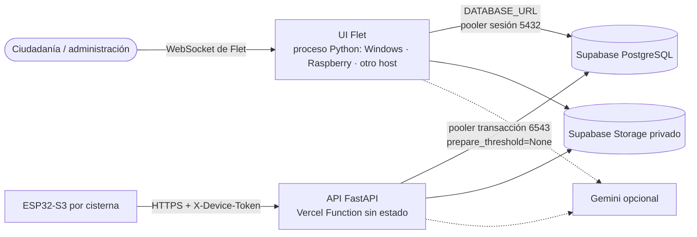

# Arquitectura de HIDRO360

Los componentes en **verde** existen y están probados por software; los **grises punteados** son futuros o no verificados en hardware.

```mermaid
flowchart LR
    C([Ciudadano<br/>mensaje de texto]):::ext --> B[Bandeja de reportes<br/>Flet / POST /reportes]:::ok
    B --> I[Ingesta<br/>reglas · Gemini opcional + fallback]:::ok
    I --> V[Validación humana<br/>revisar · editar · confirmar]:::ok
    V --> D[Deduplicación y sector<br/>sugiere, nunca fusiona]:::ok
    D --> P[Priorización<br/>fórmula determinista]:::ok
    P --> PL[Planificador<br/>flujo máximo lexicográfico]:::ok
    PL --> A[Aprobación humana<br/>aprobar · editar · rechazar]:::ok
    A --> AU[(Auditoría<br/>cadena de hashes)]:::ok
    A --> COM[Borradores de comunicación<br/>no se envían]:::ok

    subgraph Datos
      DB[(SQLite local)]:::ok
      TR[(Trazas JSONL<br/>cadena de hashes)]:::ok
    end
    I -.-> TR
    V --> DB
    PL --> DB
    AU --> DB

    API[API FastAPI /api/v1<br/>tokens operador / dispositivo]:::ok
    DB --- API
    API -->|GET /estado<br/>POST /dispositivos/confirmaciones| ESP[ESP32-S3 + pantalla 2.8in<br/>firmware escrito, SIN compilar ni probar]:::fut
    API --> RPI[Raspberry Pi 4<br/>scripts de despliegue, SIN probar]:::fut
    GEM[Gemini google-genai<br/>opcional · probado solo simulado]:::fut -.-> I
    WA[WhatsApp / audio / imagen]:::fut -.-> B

    classDef ok fill:#d9f0e3,stroke:#11643a,color:#0b3b22;
    classDef fut fill:#f0f0f0,stroke:#888,stroke-dasharray:5 4,color:#444;
    classDef ext fill:#dbeaf5,stroke:#0f4466,color:#0f4466;
```

## Despliegue: reparto de componentes

La UI y la API comparten `services/workflow.py` y la misma base; solo cambia el proceso que las aloja. Sin `DATABASE_URL` todo corre con SQLite local (demo, Raspberry). Motivos, límites verificados de Vercel y riesgos: `docs/DESPLIEGUE.md` y `docs/DECISIONES.md` D-08.

## Reglas de la arquitectura
- `services/workflow.py` es la **única puerta** de entrada para la UI y la API; la interfaz no calcula reglas.
- Cada operación que cambia datos corre en **una transacción SQLite** junto con su entrada de auditoría.
- Trazas (cómo se ejecutó) y auditoría (qué decidió quién) son registros **distintos**, ambos con cadena de hashes.
- Máquina de estados validada en el backend (`TRANSICIONES_REPORTE`, `TRANSICIONES_PLAN`).
- Gemini propone datos estructurados; el código revalida (esquema, catálogo, evidencia); las personas deciden.
- La interfaz Flet llama a `services.workflow` en el mismo proceso (no por HTTP); la API FastAPI sirve a dispositivos e integraciones.

## Módulos
| Rol de la propuesta | Archivo |
|---|---|
| Ingesta | `services/ingest.py` (+ `services/ia_gemini.py`, `services/ia_tareas.py`) |
| Interfaz | `interface/flet_app/` (12 páginas) |
| Geolocalización y deduplicación | `services/geoloc.py` |
| Priorización | `services/prioritization.py` |
| Planificador | `services/planner.py` |
| Comunicación | `services/communication.py` |
| Supervisión humana + auditoría | `services/workflow.py`, `services/audit.py` |
| Trazas | `services/tracing.py` |
| Equidad (Gini, Spearman) | `services/equidad.py` |
| Evaluación | `evaluation/` |
